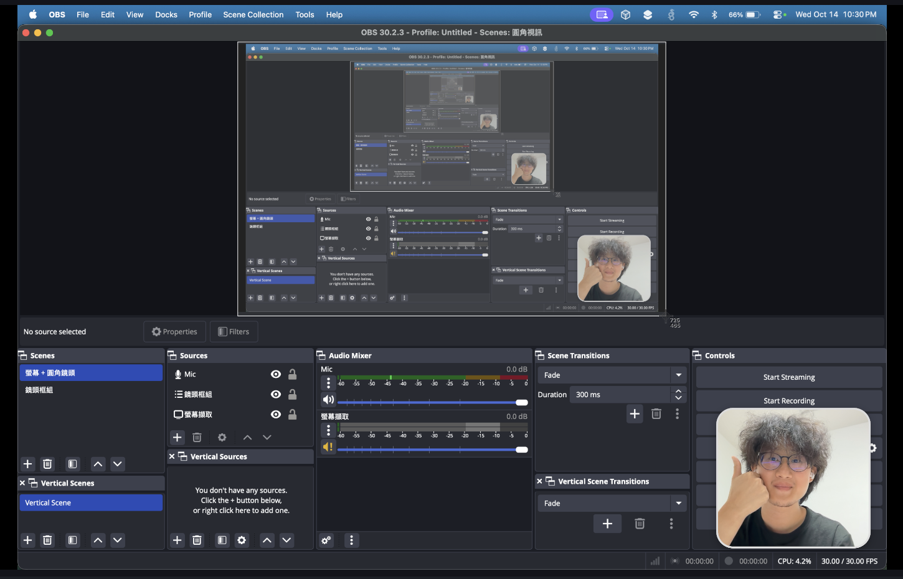

# OBS 圓角視訊 · Rounded Cam for OBS

一鍵在 OBS 加上「圓角鏡頭 + 白框 + 柔和陰影」的視訊畫面，適合錄教學、簡報、直播。



> English summary: a one-click installer that adds a new OBS scene collection with a rounded-corner webcam overlay (white border + soft shadow) on top of a full-screen display capture. macOS only, no dependencies (uses the built-in `osascript`). It never modifies your existing scene collections, and `uninstall.command` switches OBS back to the one you were using.

## 特色

- **雙擊安裝**：不用手動加濾鏡、調遮罩
- **不需要安裝任何東西**：只用 macOS 內建工具，不需要 Python
- **不動到原本的場景**：新增獨立的場景集合「圓角視訊」，移除時自動切回你原本的場景集合
- **整組移動縮放**：鏡頭與白框包在同一個子場景，拖一次就整組跟著走
- **自動沿用你的設定**：從現有場景讀取鏡頭與螢幕，並依你的畫布解析度（1080p、4K、Retina 等）自動調整大小與位置

## 系統需求

- macOS
- OBS Studio 30 以上（在 30.2.3 測試）

## 安裝

1. 下載本專案（**Code → Download ZIP** 後解壓縮，或 `git clone`）
2. 完全關閉 OBS（`Cmd + Q`）
3. 雙擊 `install.command`
4. 打開 OBS，會直接進入「圓角視訊」場景集合
5. 第一次使用需到 **系統設定 → 隱私權與安全性**，允許 OBS 使用「相機」與「螢幕與系統錄音」

### macOS 擋住 `install.command` 怎麼辦？

從網路下載的 ZIP 會被 macOS 標記，雙擊時可能出現「無法打開」。任選一種方式：

- **系統設定 → 隱私權與安全性**，往下捲到安全性區塊，按 **「仍要打開」**
- 或打開「終端機」，輸入 `bash `（後面有一個空格），把 `install.command` 拖進視窗，按 Enter

用 `git clone` 下載的不會被擋。

## 場景說明

| 場景 | 內容 |
| --- | --- |
| 螢幕 + 圓角鏡頭 | 主場景：螢幕全畫面 + 右下角圓角鏡頭 + 麥克風 |
| 鏡頭框組 | 白框 + 圓角鏡頭。在主場景中拖曳、縮放它即可整組調整位置與大小 |

安裝程式會寫入或修改：

| 位置 | 用途 |
| --- | --- |
| `~/Library/Application Support/obs-studio/basic/scenes/Rounded_Cam.json` | 「圓角視訊」場景集合 |
| `~/Library/Application Support/obs-studio/rounded-cam/` | 遮罩、白框圖片，以及原本使用的場景集合名稱 |
| `~/Library/Application Support/obs-studio/user.ini`（OBS 31+）或 `global.ini` | 只改 `SceneCollection` 兩行，讓 OBS 下次啟動直接開「圓角視訊」 |

## 移除

完全關閉 OBS 後，雙擊 `uninstall.command`。它會刪掉上面的場景集合與圖片，並把 OBS 切回你安裝前使用的場景集合。

## 常見問題

**鏡頭或螢幕是黑的**
安裝程式會從你現有的場景集合找鏡頭與螢幕；如果找不到（例如第一次用 OBS），請在「鏡頭框組」中對「圓角鏡頭」按右鍵 →「內容」選擇相機；螢幕擷取同理。

**背景變成藍色或模糊**
那是 macOS 的視訊效果。OBS 開著鏡頭時，點選單列的 **控制中心 → 視訊效果**，關閉「背景」與「人像」。

**在 OBS 裡切換場景集合時閃退**
開著 macOS 視訊效果（背景、人像、攝影棚燈光）時切換場景集合，macOS 在關閉鏡頭時可能當掉（Apple 的問題，不是 OBS 或本套件）。先關閉視訊效果再切換即可。這也是安裝程式會直接設定啟動集合、而不是讓你手動切換的原因。

**鏡頭畫面被拉伸變形**
遮罩以 16:9 鏡頭設計，預設使用 1280×720。如果你的相機不支援 720p，請在鏡頭「內容」中改用 16:9 的解析度。

**想要鏡像（左右翻轉）**
在「鏡頭框組」中對「圓角鏡頭」按右鍵 → **變形** → **水平翻轉**。

**重新安裝**
再執行一次 `install.command`。「圓角視訊」裡的修改會被重設，其他場景集合不受影響。

## 自訂圓角、白框粗細

圖片由 `make_assets.py` 產生（需要 Python 3 與 [Pillow](https://pypi.org/project/pillow/)，只有要自訂時才需要）：

```bash
pip3 install pillow
python3 make_assets.py
```

調整檔案開頭的數值：

```python
W, H, R, B, P = 480, 436, 48, 6, 30   # 可見鏡頭寬高、圓角半徑、白框粗細、陰影留白
```

> 修改 `W`、`H`、`B`、`P` 時，`install.command` 裡的同名版面數值（`const W = 480, H = 436, B = 6, P = 30`）也要一起改。改完後重新執行 `install.command`。

## 專案結構

```
.
├── install.command    # 安裝：產生「圓角視訊」場景集合
├── uninstall.command  # 移除並切回原本的場景集合
├── make_assets.py     # 產生圓角遮罩與白框 PNG（自訂時才需要）
└── assets/
    ├── cam_mask.png   # 圓角遮罩（套用在鏡頭的 Image Mask 濾鏡）
    └── cam_frame.png  # 白框 + 陰影
```

## 授權

MIT License
